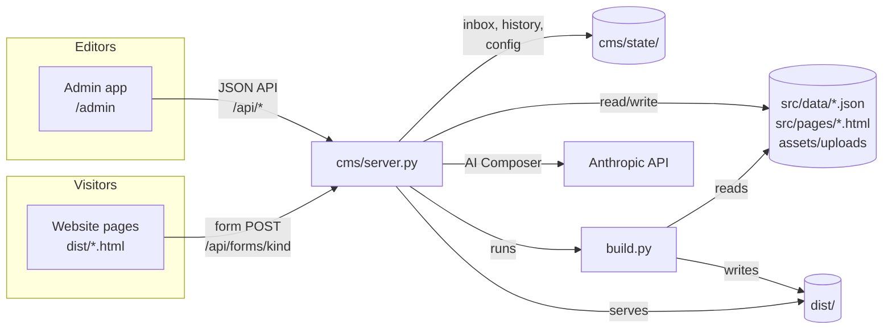

# Architecture

HIPL has two parts:

1. **A static site generator** (`hipl-website/build.py` plus `hipl-website/sitekit/`). It turns page templates and JSON content into about 46 plain HTML pages in `hipl-website/dist/`.
2. **A small CMS server** (`hipl-website/cms/`). It edits that JSON through an admin app, collects the public forms, drafts Explorations with Claude, rebuilds the site and serves it.

There is no database, no framework and no JavaScript build step. The content is the JSON in git, and the site is the HTML in `dist/`.



## Repository map

```
/
├── README.md, AGENTS.md, CLAUDE.md   Start here (people and AI agents)
├── docs/                             Developer documentation (this folder)
├── deploy/                           Docker Compose, Caddyfile, systemd unit, backup and sync scripts
├── .github/workflows/ci.yml          CI: tests on Python 3.9 and 3.12, plus a Docker smoke test
├── hipl-website/                     The product
│   ├── build.py                      Site generator (layout, nav, tokens, sitemap). Stdlib only
│   ├── sitekit/                      Renderers used by build.py and the CMS
│   │   ├── md.py                     Safe Markdown subset ([[concept]], [^n], [VERIFY])
│   │   ├── schema.py                 The 20 Explorations block types: one definition, three consumers
│   │   ├── blocks.py                 Block → HTML renderer, plus validate() (publish checklist)
│   │   └── pages.py                  Events, In Person, team, interviews, Voices, Dispatch, Reading Circle
│   ├── src/pages/                    One HTML fragment per page, with {{tokens}} for data
│   ├── src/data/*.json               All content (edited by the CMS, committed to git)
│   ├── assets/css/site.css           Design tokens and every component (no preprocessor)
│   ├── assets/js/site.js             All front-end behaviour (vanilla JS, no dependencies)
│   │                                 (build.py also writes dist/assets/js/data.js: the concept glossary for pop-ups)
│   ├── assets/brand, fonts, img      Logos (outlined SVG), self-hosted fonts, icons
│   ├── assets/uploads/               Media uploaded through the CMS
│   ├── cms/server.py                 HTTP server: admin, JSON API, public forms, static site
│   ├── cms/content_model.py          Every editable collection and its fields (drives the admin forms)
│   ├── cms/ai.py                     AI Composer (Anthropic SDK): research + compose + per-block assist
│   ├── cms/admin/                    Admin single-page app (vanilla JS)
│   ├── cms/state/                    Runtime state: NOT in git (config, inbox, history)
│   ├── dist/                         Built site (committed so static hosts and the CMS can serve it)
│   ├── tests/                        unittest suite (build, links, content, renderer, CMS API)
│   ├── tools/check.py                Runs every check; tools/check_links.py; tools/make_logos.py
│   ├── Dockerfile, requirements.txt  Container image; the only pip dependency is `anthropic` (optional)
│   └── CMS-GUIDE.md, EDITOR-GUIDE.md Guides for non-technical editors
├── hipl-launch-kit/                  Brand assets, social images, launch copy, launch checklist
└── HIPL-website-offline.zip, hipl-launch-kit.zip   Packaged copies for non-developers
```

`reels/` is a separate project (Instagram reels for a painter). It has nothing to do with HIPL. See [HANDOFF.md](HANDOFF.md).

## 1. The build (`build.py`)

`python3 build.py [--out DIR] [--drafts] [--offline] [--preview] [--demo-forms]`

1. **Load content.** Every `src/data/*.json` file is read once, at import time, into module globals (`SITE`, `EVENTS`, `DATA` for explorations, `QUESTIONS`, `TEAM` and so on).
2. **Read the page templates.** Each `src/pages/**/*.html` starts with a meta line, `<!--meta {"title": "...", "description": "...", "nav": "about"} -->`, followed by an HTML fragment (no `<html>` or `<head>`).
3. **Render tokens.** `render_data_tokens()` runs first, then `render_tokens()`.
   - Data tokens: `{{home_hero}}`, `{{launch_feature}}`, `{{events_upcoming}}`, `{{dialogues_list}}`, `{{programmes_orbit}}`, `{{founders}}`, `{{team_grid}}`, `{{partners}}`, `{{voices_grid}}`, `{{interviews_grid}}`, `{{dispatch_archive}}`, `{{circle_*}}`, `{{interview_latest_*}}`, `{{voices_featured_*}}` and more.
   - Structural tokens: `{{root}}` (relative path to the site root, so pages work from `file://`), `{{xcards:1,2,3}}` (Exploration cards), `{{qlist}}` (the 100 Questions), `{{glossary}}`, `{{ring:N}}`, and `<!--sabha(:live) ...-->` (the brand "sun" SVG, animated when `:live`).
4. **Generate pages from data** (`generated_pages()`): one page per event, interview episode, Voices article, contributor, Dispatch issue and question, the Reading Circle guide, the series pages, and every Exploration built from blocks (`sitekit.blocks.render_entry`).
5. **Wrap in the layout.** `layout()` adds the `<head>` (title, description, canonical URL from `site_url`, Open Graph), the header and nav, the announcement bar, the footer and `<body data-root data-forms>`.
6. **Write** `dist/`, then copy `assets/` and write `sitemap.xml` and `robots.txt`.

Flags:
- `--drafts` renders unpublished Explorations (the CMS preview uses it, writing to `.preview/`).
- `--offline` inlines the CSS and JS into every page so they open from disk.
- `--demo-forms` blanks the forms endpoint, so forms confirm without sending (static previews).
- `--preview` also writes `dist/_preview.html`, a page with no document wrapper, used for the claude.ai artifact preview.

The build is deterministic: it does not read today's date. Countdowns and "upcoming/past" ordering come from the data, and countdowns tick in the browser. CI therefore checks that the committed `dist/` matches the sources.

### Visibility rules
- Explorations: an entry has a page when `built: true` (a hand-written page in `src/pages/explorations/`), or when it has `blocks` and a `status` of `published` or `sample`. `--drafts` shows the rest.
- Questions: `status: "hidden"` removes a question from the site.
- Events: `upcoming`, `planned` and `past` are listed; `draft` and `cancelled` are not.
- Sample content is labelled on the page, and `[PLACEHOLDER]` text is styled as a placeholder.

## 2. Explorations blocks (`sitekit/schema.py`)

`BLOCKS` is the single source of truth for the 20 interactive block types (hook, context, chapter, pull quote, knowledge cards, meaning layers, scenarios, dilemma, compare, characters, scene, map, timeline, poll, interpretations, why, image, video, callout, text). It has three consumers:

| Consumer | Uses `BLOCKS` to |
|---|---|
| `sitekit/blocks.py` | Render each block to accessible HTML with `data-*` hooks that `site.js` brings to life |
| `cms/admin/admin.js` (via `/api/schema`) | Build the Studio forms for each block |
| `cms/ai.py` | Generate a strict JSON schema (`entry_json_schema()`) for Claude's structured output |

To add a block type, see [DEVELOPMENT.md](DEVELOPMENT.md#add-an-explorations-block-type).

## 3. The CMS server (`cms/server.py`)

A single process built on `http.server.ThreadingHTTPServer`, with no dependencies.

| Path | What |
|---|---|
| `/admin/` | Admin single-page app (`cms/admin/`) |
| `/api/*` | JSON API for the admin app (session cookie and `X-HIPL: 1` header). See [CMS-API.md](CMS-API.md) |
| `/api/forms/<kind>` | Public form endpoint (no auth; rate-limited; honeypot) |
| `/api/health` | Health check |
| `/preview/*` | Draft preview build (`.preview/`), signed-in users only |
| `/*` | The built website from `dist/` (clean URLs: `/about` serves `about.html`) |

How it works:
- **Writes.** Every content save writes `src/data/<file>.json` atomically (temp file plus `os.replace`, under a lock). It first copies the old version to `cms/state/history/<file>/` (60 versions are kept). Page HTML edits go to `src/pages/` and are kept in history too.
- **Inbox.** Form submissions are appended to `cms/state/inbox/<kind>.jsonl`. Pitch attachments go to `cms/state/inbox/files/`. Approving a `question` adds it to `questions.json`; approving a `comment` attaches it to its question.
- **Build and publish.** "Publish" runs `build.py` as a subprocess. "Preview" runs it with `--drafts --out .preview`. "Deploy" also POSTs to an optional deploy hook URL (for example Vercel).
- **AI jobs** run in background threads and the admin app polls `/api/jobs/<id>`. Jobs live in memory and are lost on restart.
- **Sessions** are in memory too: a restart signs everyone out.
- **The content model** (`content_model.py`) describes each collection: its file, the JSON path, the key field and the fields with their kinds. The admin app renders forms generically from it, so adding a field there makes it editable.

The site does not need the CMS: `dist/` is plain files. The CMS is needed to edit content through a browser and to receive the forms.

## 4. The AI Composer (`cms/ai.py`)

It uses the official Anthropic Python SDK (`anthropic` 2.x) and the default model `claude-opus-5-5` (configurable in Settings).

1. **Research** (optional, "Deep research"): `messages.stream` with the server tools `web_search_20260209` and `web_fetch_20260209`, looping on `pause_turn`. The system prompt is `EDITORIAL_RULES`, which sets the source preferences and bans invention.
2. **Compose**: one call with `output_config.format = json_schema(entry_json_schema())` and `effort: high`. It returns `{title, slug, hook, level, read, topics, element, blocks[], sources[], editor_notes}`. If the API rejects structured output, it retries asking for plain JSON and parses it with `parse_json()`.
3. **Clean**: `clean_entry()` drops unknown block types and fields, normalises the slug, and always sets `status: "draft"` and `made_with: "ai-composer"`.
4. **Assist**: `assist_block()` rewrites one block from an instruction ("shorter", "add two cards on artha and kama").

Every call goes through `client.beta.messages.stream(betas=["server-side-fallback-2026-07-01"], fallbacks="default", ...)`. This server-side fallback lets Anthropic retry a declined request on a fallback model. `refusal` and `max_tokens` stop reasons are surfaced to the editor as readable errors (`AIError`), and so are auth, permission, rate-limit, bad-request and connection errors.

Attachments: images become image content blocks and are saved to the media library. PDFs become document blocks. Text and article paste are passed as text.

Status: the code is checked against mocks and the SDK's request shapes, but it has **not been exercised against the live API yet** (no key was available). Run one real draft as part of acceptance ([HANDOFF.md](HANDOFF.md)).

## 5. Front end (`assets/js/site.js`, `assets/css/site.css`)

One IIFE with no dependencies, organised by feature. Each feature finds its elements by class or `data-*` attribute, so a block works wherever its markup appears:

- Generative cover art and scenes (`<canvas data-art|data-scene|data-face>`), seeded per entry.
- The live "sun" (`.sabha-live`). Each bar's breathing animation is on the `rect`. The pointer lean is on a wrapping `<g class="lean">`, updated once per animation frame, so the two transforms never fight.
- Interactives: knowledge cards, meaning layers, scenario tabs, dilemmas, polls (results kept in `localStorage`), compare cards, character cards, map (`data-lat`/`data-lon`), timeline, concept pop-ups (`data.js`), claim labels.
- Forms (`form.js-form[data-kind]`): validation, honeypot, `collect()` (files sent as base64), and a POST of JSON to `body[data-forms] + kind`. With no endpoint, or when opened from `file://`, they confirm without sending.
- **Share engine.** Any element with `data-share-card` gets a share button. It draws brand-styled PNGs on a canvas (post 1080×1350, story 1080×1920) and offers `navigator.share` with files, downloads, WhatsApp, X, LinkedIn, Facebook, Telegram, copy link and caption. Selected text can be shared as a quote card, and poll and dilemma choices can be shared. `window.HIPLShare` exposes it.
- Countdowns (`data-countdown`), `.ics` downloads (`data-ics`), the dismissible announcement bar, and analytics hooks (`window.plausible` if present; cookieless).

CSS: design tokens are custom properties on `:root` (Sabha palette: midnight, saffron, marigold, lotus, chalk). The fonts are Unbounded, Instrument Sans and Mukta (for Devanagari), all self-hosted. The site is mobile-first and respects `prefers-reduced-motion`.

## 6. Data flow when hosted

```
Editor saves in /admin ──► src/data/*.json (+ history) ──► Publish ──► build.py ──► dist/ ──► served at /
Visitor submits a form ──► /api/forms/<kind> ──► cms/state/inbox ──► Editor approves ──► content JSON
Server cron ──► deploy/sync-content.sh ──► git commit + push of content and dist/ (backup and audit trail)
Server cron ──► deploy/backup.sh ──► tar of cms/state + content
```
